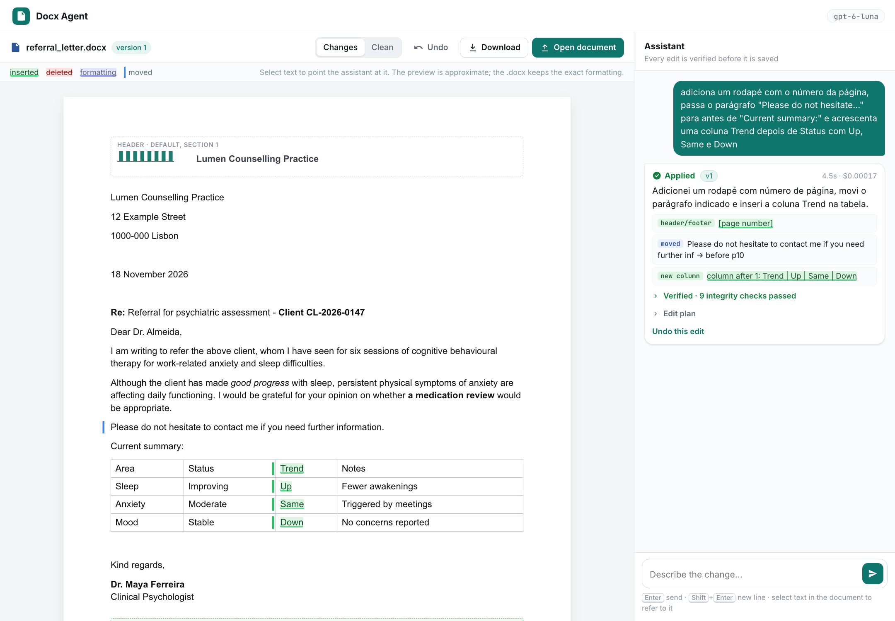

# Docx Agent

A LangGraph agent that edits **existing Word (.docx) documents** from natural-language
instructions, and changes **only** what the instruction requires. Examples: "change the session
number to 7 of 12", "make all the green text purple", "remove the emojis", "delete the
set_date row from the table", "make a table with 1 to 10", or "make this bold" with text
selected. It remembers the conversation, so "give it the same colour as the warning" or
answering its own question works. Styles, run formatting,
tables, images, links, fields, comments, headers and footers outside the edit stay exactly as
they were, and every edit is checked mechanically before it is saved.

It ships with a CLI and a web UI. The web UI has a chat panel, lets you point at the document
by selecting text, and shows a redline of each change. The test suite treats document
integrity as the main requirement. The default model (`gpt-6-luna`) costs about **$0.0001 per
edit**.



---

## Quick start

Requirements: Python ≥ 3.12, [uv](https://docs.astral.sh/uv/), an OpenAI API key.

```bash
uv sync
cp .env.example .env        # then put your OPENAI_API_KEY in .env
```

**Web UI** (open a .docx or a sample, select text if you want, chat, review the redline, download):

```bash
uv run docx-agent serve     # http://127.0.0.1:8000
```

**CLI**

```bash
uv run docx-agent edit samples/input/session_note.docx \
  "Change the session number to 7 of 12 and add 'Grounding exercise' as another intervention" \
  -o out.docx
uv run docx-agent outline samples/input/session_note.docx                  # what the agent sees
uv run docx-agent apply samples/input/session_note.docx \
  samples/output/session_note.plan.json -o replay.docx                     # replay a plan, no LLM
```

**Tests and evals**

```bash
uv run pytest                    # 183 offline tests (no network, about 30 s)
uv run pytest -m llm             # end-to-end tests against the real API
uv run python evals/run.py       # behavioural evals against the real API (51 cases)
```

**Using the web UI**
- **Open** a document from the start page (drop a file or pick a sample) or with **Open
  document** in the toolbar at any time. The logo returns to the start page.
- **Select text** in the preview exactly as you would to copy it. The selection stays
  highlighted in green while you type, and the exact text, with the block ids it covers, goes
  with your next message. So "make this bold", "apaga" or "translate this" act on precisely
  that text.
- **The chat remembers the conversation.** Every message starts a fresh run on the latest
  version, with a compact transcript of the earlier messages and the edits made. This
  resolves "the same colours as the others", "make it bold" and answers to the agent's own
  questions. Each reply shows what changed, the integrity report, the plan, the time taken and
  the cost; questions come with quick-reply buttons.
- **Changes / Clean** toggles the redline. Every edit is a version you can view, download or
  undo.

**Samples** (synthetic, no real patient data): `samples/input/*.docx` are the inputs.
`samples/output/` holds the edited documents, the plan that produced each one, and
[`EXAMPLES.md`](samples/output/EXAMPLES.md) with each instruction, its changes and its
verification report.

---

## Architecture

```
src/docx_agent/
  document/            deterministic core (no LLM)
    package.py         opens the .docx zip, rewrites only word/document.xml
    model.py           text view: blocks with stable ids, paragraphs as "pieces"
    ops.py             the 25 edit operations + run-level edit engine
    oracle.py          replays a plan on plain strings (independent model)
    verify.py          9 integrity checks: before vs. after vs. oracle
    render.py          HTML preview + redline for the UI
  agent/               LangGraph
    graph.py           state, nodes, routing
    tools.py           tool schemas exposed to the LLM
    prompts.py         planner system prompt
  service.py           run / resume (human-in-the-loop) API used by CLI and web
  conversation.py      transcript of earlier chat turns (conversation memory)
  cli.py, web/         Typer CLI, FastAPI app + static frontend (no build step)
```

### The graph


- **The LLM only plans.** It sees an outline of the document and must answer with exactly
  one tool call (`tool_choice="required"`). Applying, verifying and saving are deterministic
  nodes.
- **Every failure goes back to the planner as a precise error.** Examples: *"'Dr Maya
  Ferreira' was not found in p1. Closest text: 'Dr. Maya Ferreira'"*, or *"'the client' occurs
  4 times (in p2, p5, t0.r1.c1.p0). Give a block_id…"*. Retries are bounded:
  `max_plan_attempts=3` and `max_planner_steps=10`. If nothing safe can be produced, no file is
  written.
- **Ambiguity becomes a question, not a guess.** `ask_clarification` triggers a LangGraph
  `interrupt()`. A checkpointer keeps the run, and the CLI or UI resumes it with
  `Command(resume=answer)`.
- **Out-of-scope requests are declined explicitly**, for example image changes, new table
  rows or headers. The agent does not attempt something it cannot verify.
- The planner can use read-only tools (`search_document`, `read_blocks`). They matter when a
  long document's outline is truncated in the prompt.

### What the LLM sees

The LLM never sees the XML. It sees one line per block, with a stable id:

```
[p5] (Normal) "The client reported improved sleep over the past two weeks, … Work-related anxiety remains …"  {bold="improved sleep"; italic="two weeks"}
[t0] TABLE 5 rows x 2 cols (rows t0.r0-t0.r4)
  [t0.r2.c1.p0] (Normal) "6 of 12"
[p13] (Normal) "⟦IMAGE#1⟧"  {images: ⟦IMAGE#1⟧ 416x156px "Picture 1"}
[p19] (Normal) "Resource shared: Sleep hygiene leaflet (opens in browser)."  {link="Sleep hygiene leaflet"}
[p1] (Normal) "Note: this reference is generated from synthetic data."  {all color #70AD47; bold="Note: "}
```

Edits address text by **block id + exact anchor text**, never by character offsets or XPath.
Anchors are short to type and simple to validate, and a near-miss produces a useful
correction hint.

### Edit operations

| op | what it does |
|---|---|
| `replace_text` | Replace exact text in one paragraph, or across the whole document with `occurrence: "all"`. |
| `delete_text` | Delete exact text. It is refused if it would leave a double space; the planner is told to include the space. |
| `insert_text` | Insert before or after an anchor, or at the start or end of a paragraph. |
| `insert_paragraph` | Insert new paragraph(s) before or after a paragraph or table. `format_like` names the paragraph whose style, list numbering and run formatting to copy. |
| `delete_paragraph` | Delete a paragraph. It is refused when that would lose content or break structure: images, fields, comment anchors, half of a bookmark, a section break, the last paragraph of a table cell, or the paragraph separating two tables. |
| `format_text` | Set bold, italic, underline, strike, colour, highlight or font size on exact text. Runs are split at the boundaries and the properties are written in schema order. |
| `restyle_text` | Change the formatting of **all** existing text that has some formatting now, e.g. `{"match": {"color": "70AD47"}, "set": {"color": "7030A0"}}` for "make the green text purple". If nothing matches, the error lists the values that do exist so the planner can correct itself. |
| `delete_images` | Delete pictures by ref (`#12`, shown in the outline with their size), by paragraph, or by size (`max_size_px` for icons and emojis). Shapes and text boxes are never deleted. `delete_paragraph` needs `delete_images: true` to remove a paragraph that holds pictures. |
| `delete_table_rows` | Delete whole rows (`t1.r23`). It is refused if it would empty the table, or if a row starts a vertical merge that continues below. |
| `insert_table_row` | Insert a row next to an existing one, one text per cell. It copies a template row's properties and each cell's first paragraph, never as a header row and never vertically merged. |
| `delete_table` | Delete a whole table. |
| `insert_table` | Create a new table from rows of cell texts, with an optional bold, repeating header row. It copies an existing table's look (`table_like`) or uses single borders across the text width, and adds an empty paragraph where Word needs one (between two tables, or at the end of the body or a cell). |
| `insert_table_column` / `delete_table_columns` | Add a column (copying a column's cells) or delete columns, in tables without merged cells; the column grid is updated. |
| `blocks_to_table` | Put existing consecutive paragraphs and tables into a new table, one block per cell ("put everything in a table"). The blocks keep their exact XML; tables become nested tables. |
| `move_blocks` | Move paragraphs and tables (reorder, move a section, move to the end). The elements move unchanged, with pictures, links and fields. It is refused if it would leave two tables touching or a cell without a paragraph. |
| `duplicate_blocks` | Copy paragraphs/tables. Copies drop bookmarks and comment anchors (which must be unique) and get fresh drawing ids. |
| `set_paragraph_format` | Change a paragraph's style (heading levels, Normal, Title… only styles that exist in the document), its alignment, or remove list numbering. |
| `split_paragraph` / `merge_paragraphs` | Split at an exact text, or join consecutive paragraphs into the first one. Inline formatting is kept on both sides. |
| `insert_page_break` | A page break before or after a block ("new page"). Page-break paragraphs can also be deleted. |
| `insert_hyperlink` / `remove_hyperlink` / `set_hyperlink_url` | Turn text into a link, unlink it while keeping the text, or change where a link points. Links get a new relationship; existing relationships are never changed. |
| `create_header_footer` | Add a header or footer (text, optional page number, alignment) to sections that have none. Existing headers and footers are edited with the normal text operations (`ftr1.p0`, …). |

Row ids keep their original numbering for the whole plan, so "delete r3, then insert after
r5" means the rows the planner saw. Templates are always taken from the original document,
and deletions and duplicates apply only to blocks that are still exactly as they were. That
makes the result independent of the order the operations are listed in. A plan that would
violate this is refused with a message, so the planner splits it into two requests.

### Why it preserves formatting

A Word paragraph is a sequence of *runs*. Each run has its own formatting (`rPr`), and real
documents split words across runs all the time (`"anx" + "iety"`). The engine maps the visible
text of a paragraph to *pieces*. A piece is a `<w:t>` of an ordinary run, or a
**protected** element: a tab, line break, image, field result, tracked change, content
control, footnote reference or equation. Then, for an edit:

- **Only the `<w:t>` nodes inside the matched range change.** The new text goes into the run
  where the match starts, so it inherits that run's formatting. Neighbouring runs are trimmed,
  and only runs left empty are removed.
- **Untouched runs, `rPr`, `pPr` and other nodes are never re-created**, so they stay
  byte-identical.
- **Protected content is never edited.** An edit that overlaps it is refused. A deletion may
  remove a tab or line break only if it covers it completely.
- **An edit may not cross a hyperlink boundary.** Text typed next to a link is placed
  *outside* the link.
- **Only what an edit needs is rewritten.** That is `word/document.xml`, the header/footer
  parts that were edited, and *additions* to the document's relationships and content types
  (for new links and new headers/footers). Styles, numbering, media, comments, footnotes,
  settings and metadata (`docProps`) are copied from the input zip byte-for-byte, and so are
  headers and footers that were not edited.
- **Inserted paragraphs copy their template paragraph.** They take a deep copy of its `pPr`
  (minus section breaks and tracked-change markup) and the `rPr` of its dominant run.

---

## How integrity is verified and tested

There are three layers. The first runs on **every edit at runtime**. The other two run in CI
and during development.

**1. The runtime verifier (`document/verify.py`)**

Every candidate output goes through 9 checks before it is saved. If one fails, the file is
discarded and the planner gets the failure report. The checks compare the original document,
the edited document, and an **independent oracle**: `oracle.py` replays the same plan on plain
Python strings and tracks the origin of every character.

1. The output reopens, with both our parser and python-docx as an independent reader.
2. Every package part except `word/document.xml` is byte-identical.
3. The block structure (paragraphs, tables, sections, other elements) matches the plan's
   prediction.
4. Every block the plan did not target is **XML-identical** (exclusive C14N) to the original.
5. Edited paragraphs contain exactly the text the oracle predicts.
6. In edited paragraphs, the paragraph properties are unchanged, every original character
   keeps its exact run formatting and container (e.g. the hyperlink), and inserted text reuses
   formatting that already existed in that paragraph. Formatting changes only where
   `format_text` asked for it.
7. New paragraphs and rows have exactly their template's paragraph, row and cell properties
   and run formatting (header-repeat and vertical merges stripped).
8. The counts of images, tables, links, fields, bookmarks, comment anchors, notes, sections
   and tracked changes are preserved, minus exactly what the plan removes (the oracle lists
   every removed paragraph, row, table and picture).
9. OOXML structure rules hold: every table cell ends with a paragraph, and the body ends with
   its `sectPr`.

**2. Offline test suite (183 tests, about 30 s, no network)**

- **Engine unit tests** (`test_ops.py`) cover each operation and each refusal. They use
  synthetic XML with split runs, hyperlinks, fields, tracked changes, content controls,
  bookmarks, nested tables and section breaks. Every successful edit in them also has to pass
  the verifier.
- **Mutation tests** (`test_verify.py`) take a correct edit, tamper with the output the way a
  buggy editor would, and check that the verifier catches each case. The tampering includes
  changing an untouched paragraph, dropping bold from an edited paragraph, adding text,
  restyling a new paragraph, deleting an image, deleting a paragraph and editing `styles.xml`.
- **A fuzz test** (`test_fuzz.py`) runs 1,200 random plans, mixing all 25 operations
  (including headers/footers), on three sample documents. Each plan is either refused with an `EditError` or passes every check;
  nothing is silently corrupted. About 670 of them are applied and verified. During
  development it was also run with 30+ other seeds. It found about a dozen real interaction
  bugs while the structural operations were being built, for example:
  - a new table placed inside a row that a later operation deletes,
  - content moved into a table that is then deleted,
  - a template paragraph restyled before it is copied,
  - pictures duplicated and then deleted.
- **Graph tests** (`test_graph.py`) use a scripted LLM to exercise every route: happy path,
  exploration, error feedback and correction, schema errors, the retry limit, the
  clarification interrupt and resume, decline, nudge, the step limit and bad input.
- **Web API tests** (`test_web.py`), **package tests** (round-trip losslessness, XXE, malformed
  input), and **replay tests** that rebuild the committed sample outputs from their plans and
  check them byte-for-byte.
- **Mutation tests for the new operations** check that the verifier catches an extra row
  deleted, a new row marked as a header, an extra picture removed, and a colour changed outside
  the match.
- **Regression tests** (`test_regressions.py`) cover the issues found in code review: HTML
  injection through document attributes, LLM/API errors, several tool calls in one message,
  formatting a range that ends on a tab, custom XML blocks, the paragraph after a final table,
  the cost of near-miss suggestions, and where deleted cell paragraphs appear in the redline.

**3. Behavioural evals against the real model (`evals/`)**

There are 51 cases across 4 documents, some of them multi-message conversations run
exactly as the web UI runs them. They cover replacements in table cells, global
renames, list items, sentence and paragraph deletion, new sections (heading and body),
formatting, multi-edit instructions, link text, a word split across runs, an ambiguous date
(which must trigger a clarification), out-of-scope requests (which must be declined), text that
does not exist, a Portuguese instruction, a truncated outline (which forces the search tool),
**a prompt injection inside the document**, recolouring ("make the green text purple"),
removing icons, deleting, inserting and removing table rows and tables, highlight and colour,
instructions that refer to a selection ("make this bold", "traduz isto para português",
"apaga" right after an unrelated question), new tables ("faz uma tabela … 1 até 10"), and
follow-ups that only make sense with memory ("give it the same colour as the warning", "make
it bold", answering the agent's question in a new message). They also cover structure:
- reordering sections and moving a selection to the end on a new page,
- duplicating, splitting and joining paragraphs, and changing heading levels,
- adding and removing table columns, and turning paragraphs (or a whole document) into a table,
- inserting and removing links, and editing or creating footers with page numbers.
Each case checks the outcome: required and forbidden text, the styles of new paragraphs, bold
or italic, colours present or absent, picture count, table row counts and no empty rows, how
many paragraphs changed (to catch over-editing), no new double spaces, and that verification
passed. The runner also records token usage and estimated cost. Results are in
[`evals/results/latest.md`](evals/results/latest.md) (latest run of the default model); the model comparison below is in [`evals/results/model-comparison.md`](evals/results/model-comparison.md).

| model | passed (× 3 runs) | median latency | avg cost / edit |
|---|---|---|---|
| **gpt-6-luna** (default, low reasoning) | **153/153** (51 cases) | 2.4 s | **$0.0001** |
| gpt-5.4-mini | 90/90 (first 30 cases) | 2.2 s | $0.0012 |
| gpt-5-mini | 90/90 (first 30 cases) | 3.3 s | $0.0007 |
| gpt-5.5 (previous default) | 30/30 (1 run) | 2.3 s | $0.0118 |

The prompt was tuned against this suite. The first gpt-4.1 run scored 16/18; the two failures
led to the rules about "one insert per style" and "ask when ONE thing has several candidates".
Later, `gpt-6-luna` once picked a different purple, which led to the colour-name table in
`agent/prompts.py`. The static rules come before the document in the prompt, so repeated calls
reuse the provider's prompt cache (over 99 % of input tokens on a follow-up call in a
900-block document).

**4. Real Word check.** Heavily edited outputs were opened in Microsoft Word for Mac through
AppleScript. Every operation type was applied, including rows deleted and inserted, 61 icons
removed from a 960-paragraph technical document, and restyled text. They opened with no repair
prompt. Word reported the expected row and picture counts, and the PDF exports showed the
header image, tables, lists, chart, caption and comment intact.

---

## Key decisions and trade-offs

- **Anchors instead of offsets.** LLMs are bad at counting characters but good at copying
  text. An exact, unique anchor is easy to validate and gives useful errors. The cost is that
  the planner must copy text exactly, which the "did you mean" hints cover.
- **Plan, then execute, instead of a free-form ReAct loop over editing tools.** The whole plan
  is validated and applied to a copy as one unit, so a failure halfway never leaves a
  half-edited document, and plans can be stored and replayed (`docx-agent apply`). Read-only
  exploration is still a loop inside the graph.
- **A second, independent implementation as the test oracle.** The XML engine and the string
  oracle must agree on every character. This is what makes the fuzz test meaningful.
- **Refuse instead of guessing.** Overlapping protected content, ambiguous anchors, deleting
  paragraphs that hold bookmarks, and deleting rows that start a vertical merge all produce
  explicit errors or a decline. Pictures are only removed when the plan says so explicitly.
  The case brief values transparent limitations, and so does this design.
- **Rewrite as little as possible.** Every part an edit does not need is copied
  byte-for-byte, which turns "nothing else changed" into a byte-level fact. Relationships and
  content types may only *gain* entries, and the verifier checks each added entry.
- **A cheap model is enough because the hard part is deterministic.** The LLM only chooses
  operations; the engine and verifier do the risky work. `gpt-6-luna` passes the same suite as
  models costing 10-100× more. `DOCX_AGENT_MODEL` overrides it, and the UI shows the
  estimated cost of every edit.

## Known limitations

- **Footnotes, endnotes, comments and text boxes** are preserved but cannot be edited.
  Headers and footers can be edited and created.
- **Partial table and image support.** Merged cells are preserved, but they cannot be merged
  or split, and columns cannot be added or removed in tables that contain merged cells.
  Pictures can be deleted, moved and copied, but not inserted, resized or replaced. A deleted
  picture's media file stays in the package unreferenced (Word ignores it), because media
  parts are never rewritten.
- **No new styles.** `set_paragraph_format` uses styles that already exist in the document.
- **Fields and tables of contents are not updated.** Fields are protected, and Word updates
  them (e.g. page numbers, a TOC) when the document is opened or printed.
- **Text inside protected elements cannot be edited.** This covers tracked changes, content
  controls, fields and equations. The text around them can be edited.
- **New text formatting is limited.** New text inherits the formatting where it is inserted.
  New paragraphs copy one template paragraph, so mixed formatting inside a *new* paragraph
  (e.g. a bold label) is not supported in one step; the planner adds `format_text` afterwards.
  Formatting that comes from a style (e.g. bold headings) is shown only when applied
  directly, and `restyle_text` matches direct formatting only.
- **Fields are tracked per paragraph.** A complex field that spans several paragraphs, such
  as a table of contents, is treated per paragraph, so its entries look like editable text.
- **Matching is exact.** There is no fuzzy matching; the agent relies on error feedback when
  an anchor is wrong.
- **Some combinations are split into two requests.** Within one plan, a block that was
  already changed cannot be duplicated or deleted, and a table cannot get both new rows and
  new or deleted columns. The engine refuses these with an explanation, and the planner then
  splits the work.
- **The web UI is a local demo.** It has in-memory sessions and no authentication, and its
  HTML preview is approximate. The .docx output is the source of truth.
- **The outline is capped at 60k characters** (configurable). Beyond that, the planner has to
  search, which is slower.

## Development process (optional part of the brief)

See [docs/DEVELOPMENT.md](docs/DEVELOPMENT.md).
