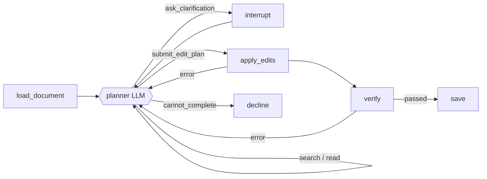

# Docx Agent

A LangGraph agent that edits **existing Word (.docx) documents** from plain-language
instructions and changes **only** what the instruction asks for. Open any .docx you have and
ask for "change the date to 20 November", "make the green text purple", "remove the emojis",
or select text and say "make this bold". Everything outside the edit stays byte-identical,
and every edit is checked mechanically before it is saved. The default model (`gpt-6-luna`)
costs about $0.0002 per edit.


## Quick start

Requires Python ≥ 3.12, [uv](https://docs.astral.sh/uv/) and an OpenAI API key.

1. Install and create the settings file:

   ```bash
   uv sync
   cp .env.example .env
   ```

2. Open `.env` and replace `sk-...` with your OpenAI API key.

3. Start the app, then open http://127.0.0.1:8000 and drop in any .docx:

   ```bash
   uv run docx-agent serve
   ```

Optional: install [LibreOffice](https://www.libreoffice.org) (`brew install --cask libreoffice`
on macOS, `apt-get install libreoffice-writer` on Linux) and the **Document** view shows the
real pages, laid out by LibreOffice. Without it the app shows its own close approximation.

## Features

**Plain-language editing.** Describe the change in your own words. The agent works out
which paragraphs, cells or rows are meant and edits only those. Typos, renames, new
paragraphs, deletions and rewording all work the same way.

**Formatting that survives.** Edited text keeps the exact formatting of the words around it:
font, size, colour, bold and links. Text you do not touch is not rewritten at all, so styles,
lists, images, fields and comments stay exactly as they were.

**Formatting changes.** Bold, italic, underline, colours, highlight and font size on any
text. You can also recolour by rule ("make all the green text purple"), change heading levels
and styles, align paragraphs, or give a paragraph a background colour.

**Tables.** Create tables (also from existing paragraphs), and add, delete, reorder or
reverse rows. You can also add and delete columns, delete whole tables, and edit any cell's
text.

**Document structure.** Move, duplicate, split and merge paragraphs or whole sections. Add
page breaks, add, remove or change links, and edit or create headers and footers with page
numbers.

**Pictures, text boxes and shapes.** Delete pictures or small icons and emojis. Edit text
inside text boxes, which is how most documents converted from PDF hold their text, and
recolour shapes such as coloured banners.

**Select to point.** Select text in the document, as you would to copy it, and say "delete
this", "translate this" or "make this blue". The agent acts on exactly what you selected.

**A real conversation.** The chat remembers earlier messages, so "make it bold" or "use the
same colour as the warning" work. When a request is ambiguous the agent asks instead of
guessing, and it declines what it cannot do safely. You can keep typing while it works; new
messages wait in a queue.

**Real pages.** With LibreOffice installed, the Document view shows the pages exactly as a
word processor lays them out, and highlights what the last edit changed. Microsoft Word is not
needed. Without LibreOffice the app uses its own close HTML layout.

**Review, versions and undo.** Every edit shows a redline of what changed, the checks it
passed, its cost and its plan. Each edit is a version you can view, download or undo.

**Marks.** Bookmark any passage. The scrollbar beside the document shows each mark, and what
the last edit changed, so you can jump back to them.

**Verified before saving.** Every edit runs 9 integrity checks against an independent
replay of the plan before the file is written. If any check fails, nothing is saved and the
agent corrects its plan.

## How it works



- **The LLM only plans.** It sees an outline of the document (one line per block, with a stable
  id such as `p5` or `t0.r2.c1.p0`) and returns an `EditPlan`. It never sees XML or runs code.
- **Edits are addressed by block id plus exact anchor text**, not by offsets. A near-miss gets a
  "did you mean" hint and goes back to the planner, with a bounded number of retries.
- **A deterministic engine (`document/ops.py`) applies the plan.** It changes only the `<w:t>`
  nodes inside the matched range; other runs and their formatting are never re-created.

## How integrity is verified

1. **Runtime verifier (`document/verify.py`).** It runs 9 checks on every edit, comparing the
   original, the result and an **independent oracle** (`oracle.py`) that replays the plan on
   plain strings. Untouched blocks must be XML-identical, edited text must match the oracle
   character for character with the same formatting, and element counts must match exactly.
2. **Offline tests (`uv run pytest`, 220 tests).** Unit tests per operation, mutation tests that
   tamper with correct outputs and require the verifier to catch it, a fuzz test with 1,200
   random plans (each one either refused or verified), and graph tests with a scripted LLM.
   They use synthetic documents built in memory (`tests/documents.py`).
3. **Evals against the real model (`uv run python evals/run.py`).** 68 cases, including
   multi-message conversations, a prompt injection and ambiguous requests. Results are in
   [`evals/results/latest.md`](evals/results/latest.md).

| model | passed | avg cost / edit |
|---|---|---|
| **gpt-6-luna** (default) | 203/204 (68 cases × 3) | $0.0002 |
| gpt-5.4-mini | 90/90 (30 cases × 3) | $0.0012 |
| gpt-5.5 | 30/30 (1 run) | $0.0118 |

Edited outputs also open in Microsoft Word without a repair prompt.

## Limitations

- Footnotes, comments and fields are preserved but cannot be edited; Word updates fields such
  as page numbers and tables of contents itself.
- Cells cannot be merged or split, and pictures cannot be inserted or replaced.
- Only styles that already exist in the document can be applied.
- The web UI is a local demo: in-memory sessions, no authentication.

How it was built: [docs/DEVELOPMENT.md](docs/DEVELOPMENT.md).
