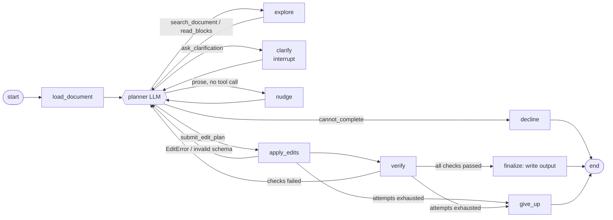

# Docx Agent

A LangGraph agent that edits **existing Word (.docx) documents** from natural-language
instructions ("change the session number to 7 of 12", "add a bullet about grounding
techniques", "remove the word 'persistent'"), and changes **only** what the instruction
requires. Styles, run formatting, tables, images, links, fields, comments, headers and footers
outside the edit stay exactly as they were, and every edit is checked mechanically before it is
saved.

It ships with a CLI, a small web UI that shows a redline of each change, and a test suite that
treats document integrity as the main requirement.


---

## Quick start

Requirements: Python ≥ 3.12, [uv](https://docs.astral.sh/uv/), an OpenAI API key.

```bash
uv sync
cp .env.example .env        # then put your OPENAI_API_KEY in .env
```

**Web UI** (pick a sample or upload a .docx, type an instruction, review the redline, download):

```bash
uv run docx-agent serve     # http://127.0.0.1:8000
```

**CLI**

```bash
uv run docx-agent edit samples/input/session_note.docx \
  "Change the session number to 7 of 12 and add 'Grounding exercise' as another intervention" \
  -o out.docx
uv run docx-agent outline samples/input/session_note.docx                  # what the agent sees
uv run docx-agent apply samples/input/session_note.docx \
  samples/output/session_note.plan.json -o replay.docx                     # replay a plan, no LLM
```

**Tests and evals**

```bash
uv run pytest                    # 96 offline tests (no network, about 10 s)
uv run pytest -m llm             # end-to-end tests against the real API
uv run python evals/run.py       # behavioural evals against the real API (22 cases)
```

**Samples** (synthetic, no real patient data): `samples/input/*.docx` are the inputs.
`samples/output/` holds the edited documents, the plan that produced each one, and
[`EXAMPLES.md`](samples/output/EXAMPLES.md) with each instruction, its changes and its
verification report.

---

## Architecture

```
src/docx_agent/
  document/            deterministic core (no LLM)
    package.py         opens the .docx zip, rewrites only word/document.xml
    model.py           text view: blocks with stable ids, paragraphs as "pieces"
    ops.py             the 6 edit operations + run-level edit engine
    oracle.py          replays a plan on plain strings (independent model)
    verify.py          9 integrity checks: before vs. after vs. oracle
    render.py          HTML preview + redline for the UI
  agent/               LangGraph
    graph.py           state, nodes, routing
    tools.py           tool schemas exposed to the LLM
    prompts.py         planner system prompt
  service.py           run / resume (human-in-the-loop) API used by CLI and web
  cli.py, web/         Typer CLI, FastAPI app + static frontend (no build step)
```

### The graph



- **The LLM only plans.** It sees an outline of the document and must answer with exactly
  one tool call (`tool_choice="required"`). Applying, verifying and saving are deterministic
  nodes.
- **Every failure goes back to the planner as a precise error.** Examples: *"'Dr Maya
  Ferreira' was not found in p1. Closest text: 'Dr. Maya Ferreira'"*, or *"'the client' occurs
  4 times (in p2, p5, t0.r1.c1.p0). Give a block_id…"*. Retries are bounded:
  `max_plan_attempts=3` and `max_planner_steps=10`. If nothing safe can be produced, no file is
  written.
- **Ambiguity becomes a question, not a guess.** `ask_clarification` triggers a LangGraph
  `interrupt()`. A checkpointer keeps the run, and the CLI or UI resumes it with
  `Command(resume=answer)`.
- **Out-of-scope requests are declined explicitly**, for example image changes, new table
  rows or headers. The agent does not attempt something it cannot verify.
- The planner can use read-only tools (`search_document`, `read_blocks`). They matter when a
  long document's outline is truncated in the prompt.

### What the LLM sees

The LLM never sees the XML. It sees one line per block, with a stable id:

```
[p5] (Normal) "The client reported improved sleep over the past two weeks, … Work-related anxiety remains …"  {bold="improved sleep"; italic="two weeks"}
[t0.r2.c1.p0] (Normal) "6 of 12"
[p13] (Normal) "⟦IMAGE⟧"
[p19] (Normal) "Resource shared: Sleep hygiene leaflet (opens in browser)."  {link="Sleep hygiene leaflet"}
```

Edits address text by **block id + exact anchor text**, never by character offsets or XPath.
Anchors are short to type and simple to validate, and a near-miss produces a useful
correction hint.

### Edit operations

| op | what it does |
|---|---|
| `replace_text` | Replace exact text in one paragraph, or across the whole document with `occurrence: "all"`. |
| `delete_text` | Delete exact text. It is refused if it would leave a double space; the planner is told to include the space. |
| `insert_text` | Insert before or after an anchor, or at the start or end of a paragraph. |
| `insert_paragraph` | Insert new paragraph(s) before or after a paragraph or table. `format_like` names the paragraph whose style, list numbering and run formatting to copy. |
| `delete_paragraph` | Delete a paragraph. It is refused when that would lose content or break structure: images, fields, comment anchors, half of a bookmark, a section break, the last paragraph of a table cell, or the paragraph separating two tables. |
| `format_text` | Set bold, italic or underline on exact text. Runs are split at the boundaries and the properties are written in schema order. |

### Why it preserves formatting

A Word paragraph is a sequence of *runs*. Each run has its own formatting (`rPr`), and real
documents split words across runs all the time (`"anx" + "iety"`). The engine maps the visible
text of a paragraph to *pieces*. A piece is a `<w:t>` of an ordinary run, or a
**protected** element: a tab, line break, image, field result, tracked change, content
control, footnote reference or equation. Then, for an edit:

- **Only the `<w:t>` nodes inside the matched range change.** The new text goes into the run
  where the match starts, so it inherits that run's formatting. Neighbouring runs are trimmed,
  and only runs left empty are removed.
- **Untouched runs, `rPr`, `pPr` and other nodes are never re-created**, so they stay
  byte-identical.
- **Protected content is never edited.** An edit that overlaps it is refused. A deletion may
  remove a tab or line break only if it covers it completely.
- **An edit may not cross a hyperlink boundary.** Text typed next to a link is placed
  *outside* the link.
- **Only the main document part is rewritten.** Styles, numbering, headers, footers, media,
  comments and settings are copied from the input zip byte-for-byte.
- **Inserted paragraphs copy their template paragraph.** They take a deep copy of its `pPr`
  (minus section breaks and tracked-change markup) and the `rPr` of its dominant run.

---

## How integrity is verified and tested

There are three layers. The first runs on **every edit at runtime**. The other two run in CI
and during development.

**1. The runtime verifier (`document/verify.py`)**

Every candidate output goes through 9 checks before it is saved. If one fails, the file is
discarded and the planner gets the failure report. The checks compare the original document,
the edited document, and an **independent oracle**: `oracle.py` replays the same plan on plain
Python strings and tracks the origin of every character.

1. The output reopens, with both our parser and python-docx as an independent reader.
2. Every package part except `word/document.xml` is byte-identical.
3. The block structure (paragraphs, tables, sections, other elements) matches the plan's
   prediction.
4. Every block the plan did not target is **XML-identical** (exclusive C14N) to the original.
5. Edited paragraphs contain exactly the text the oracle predicts.
6. In edited paragraphs, the paragraph properties are unchanged, every original character
   keeps its exact run formatting and container (e.g. the hyperlink), and inserted text reuses
   formatting that already existed in that paragraph. Formatting changes only where
   `format_text` asked for it.
7. New paragraphs have exactly the template's paragraph properties and run formatting.
8. The counts of images, tables, links, fields, bookmarks, comment anchors, notes, sections
   and tracked changes are preserved.
9. OOXML structure rules hold: every table cell ends with a paragraph, and the body ends with
   its `sectPr`.

**2. Offline test suite (96 tests, about 10 s, no network)**

- **Engine unit tests** (`test_ops.py`) cover each operation and each refusal. They use
  synthetic XML with split runs, hyperlinks, fields, tracked changes, content controls,
  bookmarks, nested tables and section breaks. Every successful edit in them also has to pass
  the verifier.
- **Mutation tests** (`test_verify.py`) take a correct edit, tamper with the output the way a
  buggy editor would, and check that the verifier catches each case. The tampering includes
  changing an untouched paragraph, dropping bold from an edited paragraph, adding text,
  restyling a new paragraph, deleting an image, deleting a paragraph and editing `styles.xml`.
- **A fuzz test** (`test_fuzz.py`) runs 500 random plans on the sample documents. Each plan is
  either refused with an `EditError` or passes every check; nothing is silently corrupted.
  About 400 of them are applied and verified.
- **Graph tests** (`test_graph.py`) use a scripted LLM to exercise every route: happy path,
  exploration, error feedback and correction, schema errors, the retry limit, the
  clarification interrupt and resume, decline, nudge, the step limit and bad input.
- **Web API tests** (`test_web.py`), **package tests** (round-trip losslessness, XXE, malformed
  input), and **replay tests** that rebuild the committed sample outputs from their plans and
  check them byte-for-byte.

**3. Behavioural evals against the real model (`evals/`)**

There are 22 cases across 3 documents. They cover replacements in table cells, global
renames, list items, sentence and paragraph deletion, new sections (heading and body),
formatting, multi-edit instructions, link text, a word split across runs, an ambiguous date
(which must trigger a clarification), out-of-scope requests (which must be declined), text that
does not exist, a Portuguese instruction, a truncated outline (which forces the search tool),
and **a prompt injection inside the document**. Each case checks the outcome: required and
forbidden text, the styles of new paragraphs, bold or italic, how many paragraphs changed (to
catch over-editing), no new double spaces, and that verification passed. Results are in
[`evals/results/latest.md`](evals/results/latest.md).

| model | pass rate (22 cases × 3 runs) | median latency | failures |
|---|---|---|---|
| **gpt-5.5** (default, low reasoning) | **66/66** | 2.1 s | – |
| gpt-5.4-mini (low reasoning) | 64/66 | 2.1 s | gave the body of a new section a list style |
| gpt-4.1 | 63/66 | 1.3 s | guessed which date to change instead of asking |

The prompt was tuned against this suite. The first gpt-4.1 run scored 16/18; the two
failures led to the rules about "one insert per style" and "ask when ONE thing has several
candidates" in `agent/prompts.py`.

**4. Real Word check.** Heavily edited outputs, with every operation type applied, were opened
in Microsoft Word for Mac through AppleScript. They opened with no repair prompt, and the PDF
exports showed the header image, table, lists, chart, caption and comment intact.

---

## Key decisions and trade-offs

- **Anchors instead of offsets.** LLMs are bad at counting characters but good at copying
  text. An exact, unique anchor is easy to validate and gives useful errors. The cost is that
  the planner must copy text exactly, which the "did you mean" hints cover.
- **Plan, then execute, instead of a free-form ReAct loop over editing tools.** The whole plan
  is validated and applied to a copy as one unit, so a failure halfway never leaves a
  half-edited document, and plans can be stored and replayed (`docx-agent apply`). Read-only
  exploration is still a loop inside the graph.
- **A second, independent implementation as the test oracle.** The XML engine and the string
  oracle must agree on every character. This is what makes the fuzz test meaningful.
- **Refuse instead of guessing.** Overlapping protected content, ambiguous anchors, deleting
  paragraphs that hold images or bookmarks, and structural table edits all produce explicit
  errors or a decline. The case brief values transparent limitations, and so does this design.
- **Only `word/document.xml` is rewritten**, which turns "nothing else changed" into a
  byte-level fact.
- **The model is swappable.** The default, `gpt-5.5` with low reasoning effort, was chosen
  from the eval results. `DOCX_AGENT_MODEL` overrides it.

## Known limitations

- **Main document body only.** Headers, footers, footnotes, comments and text boxes are
  preserved but cannot be edited.
- **No structural table or image edits.** The agent cannot add or remove table rows or
  columns, or insert, resize or replace images.
- **Text inside protected elements cannot be edited.** This covers tracked changes, content
  controls, fields and equations. The text around them can be edited.
- **New text formatting is limited.** New text inherits the formatting where it is inserted.
  New paragraphs copy one template paragraph, so mixed formatting inside a *new* paragraph
  (e.g. a bold label) is not supported. `format_text` covers bold, italic and underline only.
- **Fields are tracked per paragraph.** A complex field that spans several paragraphs, such
  as a table of contents, is treated per paragraph, so its entries look like editable text.
- **Matching is exact.** There is no fuzzy matching; the agent relies on error feedback when
  an anchor is wrong.
- **The web UI is a local demo.** It has in-memory sessions and no authentication, and its
  HTML preview is approximate. The .docx output is the source of truth.
- **The outline is capped at 60k characters** (configurable). Beyond that, the planner has to
  search, which is slower.

## Development process (optional part of the brief)

See [docs/DEVELOPMENT.md](docs/DEVELOPMENT.md).
