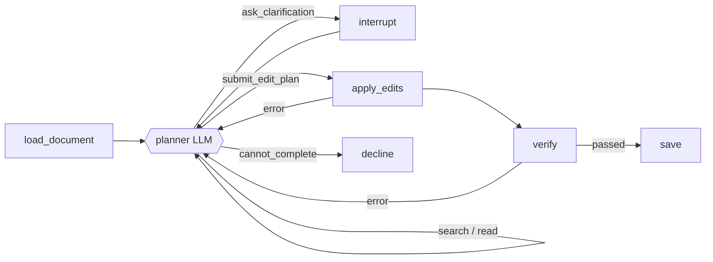

# Docx Agent

A LangGraph agent that edits **existing Word (.docx) documents** from plain-language
instructions and changes **only** what the instruction asks for. Examples: "change the session
number to 7 of 12", "make the green text purple", "remove the emojis", "make this bold" with
text selected. Everything outside the edit stays byte-identical, and every edit is checked
mechanically before it is saved. The default model (`gpt-6-luna`) costs about $0.0002 per
edit.


## Quick start

Requires Python ≥ 3.12, [uv](https://docs.astral.sh/uv/) and an OpenAI API key.

```bash
uv sync
cp .env.example .env              # put your OPENAI_API_KEY in .env
uv run docx-agent serve           # web UI on http://127.0.0.1:8000
```

The web UI has a chat panel, lets you select text to point at it, shows a redline of each
change, and keeps every version so you can undo or download it. With
[LibreOffice](https://www.libreoffice.org) installed, the **Document** view shows the real
pages (LibreOffice lays them out; Microsoft Word is not needed). The Docker image includes
LibreOffice:

```bash
docker build -t docx-agent . && docker run --rm -p 8000:8000 --env-file .env docx-agent
```

CLI, tests and evals:

```bash
uv run docx-agent edit samples/input/session_note.docx "Change the session number to 7 of 12" -o out.docx
uv run pytest                     # 224 offline tests, about 30 s
uv run python evals/run.py        # 68 behavioural cases against the real model
```

Samples in `samples/` are synthetic. [`samples/output/EXAMPLES.md`](samples/output/EXAMPLES.md)
shows each instruction with its changes and verification report.

## How it works



- **The LLM only plans.** It sees an outline of the document (one line per block, with a stable
  id such as `p5` or `t0.r2.c1.p0`) and returns an `EditPlan`. It never sees XML or runs code.
- **Edits are addressed by block id plus exact anchor text**, not by offsets. A near-miss gets a
  "did you mean" hint and goes back to the planner, with a bounded number of retries.
- **The engine (`document/ops.py`)** has 27 operations: text, formatting, paragraphs, tables,
  rows and columns, pictures, text boxes and shapes, page breaks, links, headers and footers.
  Only the `<w:t>` nodes inside the matched range change; other runs and their formatting are
  never re-created.
- **Ambiguity becomes a question** (a LangGraph `interrupt()`), and out-of-scope requests are
  declined instead of guessed.

## How integrity is verified

1. **Runtime verifier (`document/verify.py`).** It runs 9 checks on every edit. It compares the
   original, the result and an **independent oracle** (`oracle.py`), which replays the plan on
   plain strings. Untouched blocks must be XML-identical, edited text must match the oracle
   character for character with the same formatting, and element counts must match exactly.
   On failure nothing is saved and the planner gets the report.
2. **Offline tests.** Unit tests per operation, mutation tests that tamper with correct outputs
   and require the verifier to catch it, a fuzz test with 1,200 random plans (each one either
   refused or verified), and graph tests with a scripted LLM.
3. **Evals against the real model.** 68 cases, including multi-message conversations, a prompt
   injection and ambiguous requests. Results are in
   [`evals/results/latest.md`](evals/results/latest.md).

| model | passed | avg cost / edit |
|---|---|---|
| **gpt-6-luna** (default) | 203/204 (68 cases × 3) | $0.0002 |
| gpt-5.4-mini | 90/90 (30 cases × 3) | $0.0012 |
| gpt-5.5 | 30/30 (1 run) | $0.0118 |

Edited outputs also open in Microsoft Word without a repair prompt.

## Limitations

- Footnotes, comments and fields are preserved but cannot be edited; Word updates fields such
  as page numbers and tables of contents itself.
- Cells cannot be merged or split, and pictures cannot be inserted or replaced.
- Only styles that already exist in the document can be applied.
- The web UI is a local demo: in-memory sessions, no authentication.

How it was built: [docs/DEVELOPMENT.md](docs/DEVELOPMENT.md).
